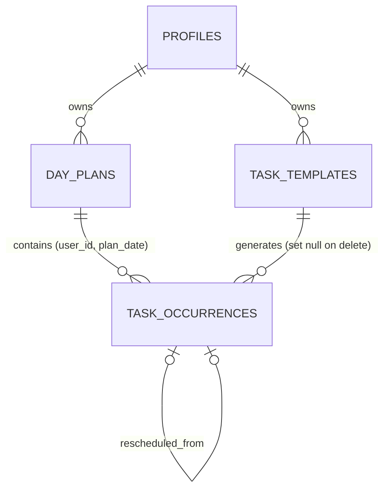

# Daily Planning & Progress Engine: specification

> **Historical note (backend migration).** This specification was written when the planned backend was Supabase/Postgres. The product rules below are unchanged and are what the app implements, but the database wording (sections 8, 15, 16: Row Level Security, triggers, `supabase/migrations`, PGlite, "status" lines) describes the retired design. The backend is now Django + SQLite: the same rules are enforced in `backend/planner/rules.py` and `backend/planner/resources.py`. See `docs/DJANGO_MIGRATION.md`; the retired SQL is in `docs/archive/supabase/`. Implementation status lives in `docs/FEATURE_TRACKER.md`, not in this file.

**Status: requirements and architecture only. Nothing in this document is implemented.** No planner code, migration or UI exists yet. Every requirement below is marked *Spec only* until it is built, and *Implemented* / *Verified* are separate states (see [Status legend](#13-status-legend)). The schema in section 6 is a **proposal for review**, not a migration and not tested.

> **A missed day is an event, not an identity. Progress should help people return, not make them feel guilty.**

## 1. Vision and principles

Arcloop helps people plan their own days, build habits, see honest progress, and grow with others. The Daily Planning & Progress Engine is its foundation: users build their own plan instead of following a predefined routine.

1. **Progress, not perfection.** A difficult day does not erase earlier progress.
2. **The plan belongs to the user.** No assumed audience (students, athletes, etc.), no universal schedule, no required categories or day modes.
3. **Honest numbers.** One documented formula. No hidden denominators, no invented precision, no fake progress.
4. **No shame.** No guilt copy, no threatening streak-loss messages, no "failed" language. Rest is legitimate.
5. **Plans change.** Festivals, travel, illness, family and rest are normal. Revising a plan never silently deletes tasks or rewrites history.
6. **Private by default.** Tasks and schedules can contain sensitive information and are visible only to their owner.

## 2. Module map and scope

| Module | Purpose | In this spec |
| --- | --- | --- |
| **My Day** | Today's plan, checklist, progress, next actions | Yes (core) |
| **My Growth** | History, weekly summaries | Basic history + weekly summary only |
| **Flexible Planning** | Day modes, exclude/reschedule, rest | Yes |
| **Challenges** | Seasonal challenges (e.g. Winter Arc 90) | Integration point only (section 9) |
| **Communities** | Groups, shared accountability | Integration point only (section 9) |

The personal planner **must work independently** of challenges and communities and must not reference any campaign, school or profession.

## 3. Feature breakdown

### A. Tasks
Title (required, 1-120 chars), description (optional, up to 1000), optional planned start (and end) time, optional estimated duration (minutes), category (built-in suggestions or custom text), optional priority flag, recurrence (**once**, **daily**, **selected weekdays**). Add, edit, complete, uncomplete, delete; add custom tasks at any time; reschedule without losing history.

*Sleep and meals:* modelled as ordinary tasks, so no new concept is needed. Sleep is two point-in-time tasks ("Bedtime" 23:00, "Wake up" 06:30) rather than one overnight span, which avoids end-before-start time ranges. See decision D7.

### B. My Day
Date and day mode; tasks in chronological order (untimed tasks after timed ones, in creation order); checklist; counts (completed / partial / pending / moved-or-excluded); progress percentage with the formula available in the UI; a calm summary line; a "plan tomorrow" action; useful empty states.

### C. Honest progress
Section 5.

### D. Remaining effort and next actions
Shows how many tasks remain, which are priorities, which can be rescheduled or shortened, and whether the remaining estimated work may fit in the time left today, **only** when enough data exists (section 5.5).

### E. Day modes
*(Minimum Day, an optional setting that works alongside these modes, is specified in section 17.)*

`normal`, `busy` (festival / busy day), `rest` (recovery). Optional: a user never has to choose one, and the default is `normal`. A mode is a label plus guided shortcuts. **Changing the mode never deletes tasks or alters check-ins.** Custom modes are out of scope.

### F. Wellbeing goals
Bedtime, wake-up, meals, hydration, exercise and rest are user-defined tasks. No calorie, weight or body metrics, no restrictive-diet suggestions, no punitive reminders. Sleep and meal planning is a personal planning aid, **not medical advice**, and the UI must say so where those categories are offered.

### G. History and recovery
Review past days (completed / partial / pending / moved / excluded); history is stable when plans change; a missed or unopened day never resets anything; every day starts with a fresh plan; weekly summary once at least 3 days with a plan exist.

## 4. User stories and acceptance criteria

All items are **Spec only**.

| ID | Story | Acceptance criteria |
| --- | --- | --- |
| DP-01 | I can add a task quickly | Given I'm on My Day, when I enter only a title and save, then the task appears in today's list. Optional fields can be added later. |
| DP-02 | I can add details | Description, start/end time, estimate, category, priority and recurrence can be set; invalid combinations (end before start, estimate ≤ 0) show a clear message and are not saved. |
| DP-03 | I can choose recurrence | One-time, daily, or selected weekdays (at least one weekday). A recurring task appears only on matching dates on or after its start date. |
| DP-04 | I can edit a task | Editing a recurring task changes future, untouched occurrences only; past days and completed occurrences are unchanged (rules in section 6.4). |
| DP-05 | I can complete and uncomplete | Tapping the control records done; tapping again undoes it. Undo never creates a second record. Completion can also be recorded as partial (0.5) with a visible explanation. |
| DP-06 | Mobile taps are safe | The completion control is at least 44 px, separated from the row's other actions; a mistaken tap can be undone from an inline "Undo" without a dialog. |
| DP-07 | I can delete a task | Deleting a task with no recorded progress removes it. Deleting something that was part of the day's original plan, or has progress, asks for confirmation and offers "Remove from today" or "Archive" (keeps history) before any permanent deletion. |
| DP-08 | My Day shows progress with its method | The percentage is shown with "N of M tasks" counts and a one-tap explanation of the formula. |
| DP-09 | Empty days are friendly | With no tasks, My Day shows an empty state that offers adding a task or copying yesterday's plan. No 0%, no NaN. |
| DP-10 | Calm messaging | Messages come from the approved set (section 5.6). No guilt wording appears anywhere. |
| DP-11 | I can see what remains | The count of remaining tasks, priority tasks, and (when data allows) whether estimated work fits are shown; absent data produces "Add estimates to see what fits", never a guess. |
| DP-12 | I can reschedule | Moving a task to another date keeps the original (marked "moved to <date>") and creates the new occurrence on that date with a link back. History is intact. |
| DP-13 | Busy / festival day | Choosing Busy Day lets me mark some tasks "not today". They leave the revised plan's denominator, stay visible in a "Set aside" group, can be restored, and remain in the original-plan view. |
| DP-14 | Original vs revised | After any revision, My Day shows both the current plan's progress and the original plan's progress, clearly labelled. Before any revision only one is shown. |
| DP-15 | Rest day | Choosing Rest Day is a valid plan. It shows "Rest day" and is not treated as 0%, a miss, or a failure in any summary. |
| DP-16 | Mode changes are safe | Switching modes changes no task, completion or history. Switching back restores the view without data loss. |
| DP-17 | I can plan tomorrow | A "Plan tomorrow" action opens the next local date with recurring tasks already present and lets me add, edit or exclude tasks. |
| DP-18 | I can review past days | Any past day with a plan can be opened read-mostly, showing completed, partial, pending, moved and excluded tasks and both progress figures where applicable. |
| DP-19 | Missing days don't punish | Days I never opened have no record and display "No plan recorded". They are never counted as 0% in any average, trend or score. |
| DP-20 | Weekly summary | After at least 3 days with plans in a week, a summary shows days with progress, tasks completed, and rest days, without a streak counter. |
| DP-21 | Local dates are correct | A task planned for the 12th appears on the 12th in my profile timezone regardless of my device clock, and across DST changes. |
| DP-22 | No duplicates | Each template has at most one occurrence per date; double-tapping or retrying never creates two completions or two occurrences. |
| DP-23 | Privacy | My tasks, descriptions and schedules are readable only by me (database-enforced). Nothing about them appears on public profiles, groups or leaderboards by default. |
| DP-24 | Accessibility | Task state is conveyed by text and role/state (not colour alone); the checklist is fully keyboard operable with visible focus; changes are announced via a polite live region. |

## 5. Progress calculation

### 5.1 Definitions
- **Completion units** per occurrence: pending = **0**, partial = **0.5**, done = **1**. Nothing else is accepted in v1 (D1).
- **Active** occurrence: part of the day's *current (revised)* plan. **Excluded** occurrence: set aside (moved, busy-day, rest-day, removed); it keeps its status and history.
- **Original plan**: occurrences that existed when the day's baseline was fixed (section 6.3).

### 5.2 Formulas
```
revised progress  = Σ units(active occurrences)          / count(active occurrences)          × 100
original progress = Σ units(original-plan occurrences)   / count(original-plan occurrences)   × 100
```
Units are always taken from the occurrence itself. Equal weighting; time-weighted or user-weighted scoring is deferred until this model is tested.

### 5.3 Display rules
- `count = 0` → progress is **`null`**, never computed. UI shows "No tasks in today's plan" (or "Rest day" in rest mode). Never `0%`, never `NaN`.
- Percentages are shown as whole numbers, rounded half up, with three safeguards: **100% is shown only when every counted unit is complete**; any progress above zero shows **at least 1%**; the underlying counts ("3 done, 1 partial, 2 pending") are always available.
- The original figure is shown **only when the plan has been revised** (any exclusion, reschedule, added-after-baseline task, or mode change after baseline). The current plan's figure leads; the original is supporting context.
- Excluded tasks are never silently dropped from view: they appear in a "Set aside" group with the reason.

### 5.4 Edge cases
| Case | Rule |
| --- | --- |
| 6 active: 3 done, 1 partial, 2 pending | (3 + 0.5) / 6 = 58.33% → **58%** |
| 0 active tasks | `null` → "No tasks in today's plan" / "Rest day" |
| Busy day: 6 in original plan, 3 set aside, 2 of remaining 3 done | revised 2/3 = **67%**; original 2/6 = **33%**; both labelled, set-aside tasks listed with reasons |
| Task rescheduled to Friday and done Friday | Counts on **Friday's** plan only. Thursday's original shows it as moved (0 units, labelled), never double-counted |
| Task added after the baseline and completed | In revised (active) progress; **not** in original |
| Complete a set-aside task anyway | Restores it to active (clears the exclusion) and counts. A rescheduled one must first have the move undone, to avoid two occurrences |
| Undo a completion | Back to pending (0 units); the completion timestamp is cleared |
| Partial on a task, later marked done | Becomes done (1.0), not 1.5 |
| 199.5 / 200 style rounding | Capped at 99% unless all units are complete |
| 0.5 / 100 | Shows 1% |
| Rest day with tasks set aside | Revised plan is empty → "Rest day"; excluded from trend averages (not 0) |
| Day never opened | No record; "No plan recorded"; excluded from trends |
| Task deleted after baseline | An original-plan task is soft-removed (excluded, reason `removed`) so the original plan stays truthful. A task added after the baseline is hard-deleted and suppressed if untouched, or soft-removed if it has partial progress. A done task cannot be removed (undo first). Before the baseline, a delete is a hard delete plus suppression and does not fix the baseline (11b, C1) |
| Task with no estimate in a fit calculation | Calculation is skipped (5.5) |

### 5.5 Remaining effort and "what fits"
- Remaining = active occurrences that are not done (a partial task still counts as remaining). Counts are always whole tasks ("Two tasks remain"); fractional counts are never shown.
- Time fit is shown only if **every** remaining active task has an estimate. Available time = now → end of the local day in the profile timezone (real elapsed time, so 23/25-hour DST days are handled). Output is hedged: "Your estimates add up to about 2 h 15 m; about 3 h 40 m is left today." If any estimate is missing: "Add estimates to see what fits."
- No predictions of completion time, no "you will not finish" messages. Rescheduling or shortening is *offered*, never imposed.

### 5.6 Approved copy
Examples (to be centralised in a constants file when built):

| State | Message |
| --- | --- |
| Some progress | "You have made progress today." |
| Tasks remain | "Two tasks remain in your current plan." |
| Nothing done yet | "A fresh plan is ready when you are." |
| All done | "Everything in today's plan is done. Enjoy the rest of your day." |
| Pending task, past planned time | "Would you like to reschedule this task?" |
| Busy day | "Keep what matters today. The rest can wait." |
| Rest day | "Rest is part of the plan." |
| Returning after days away | "Welcome back. Your earlier progress is all still here." |

**Banned:** "failed", "missed" as a judgement, "behind", "lazy", "you broke your streak", "don't lose your streak", "only X%", any comparison implying a person's worth. A streak counter is **not** part of the MVP (D9); the landing page's "streaks without shame" wording should be reviewed against this when My Growth is built.

## 6. Proposed data model (for review)

> Proposal only. Not a migration, not applied, not tested. It builds on the existing `profiles` table (which already has an IANA `timezone` and `progress_visibility`).

### 6.1 Entities
| Entity | Role |
| --- | --- |
| `profiles` *(exists)* | Owner; holds `timezone` |
| `task_templates` | **Reusable definition**: title, category, times, estimate, priority, recurrence (once / daily / weekly + weekdays), `starts_on`/`ends_on`, archived flag. "What I intend to do." |
| `day_plans` | One row per user per local date: `day_mode`, `baseline_at`. Created on first open of a day. |
| `task_occurrences` | **Date-specific instance**: self-contained snapshot of the task for one date, plus `completion` (0 / 0.5 / 1), plan state (`active` / `excluded` + reason), `in_original_plan`, `rescheduled_from_id`. "What happened on this date." |

A template and a day's check-in are different records by design. No separate "check-ins" table: completion lives on the occurrence, so there is **one source of truth** and one row per task per day. Progress is **computed, never stored**.



### 6.2 Schema sketch (illustrative)
```sql
create table task_templates (
  id uuid primary key default gen_random_uuid(),
  user_id uuid not null references profiles(id) on delete cascade,
  title text not null check (char_length(btrim(title)) between 1 and 120),
  description text check (description is null or char_length(description) <= 1000),
  category text check (category is null or char_length(btrim(category)) between 1 and 40),
  is_priority boolean not null default false,
  planned_start time, planned_end time,                 -- local wall-clock, no zone
  estimated_minutes smallint check (estimated_minutes between 1 and 1440),
  recurrence text not null check (recurrence in ('once','daily','weekly')),
  weekdays smallint[],                                   -- ISO 1=Mon..7=Sun, only for 'weekly'
  starts_on date not null, ends_on date,                 -- inclusive local dates
  archived_at timestamptz,
  created_at timestamptz not null default now(), updated_at timestamptz not null default now(),
  check (planned_end is null or (planned_start is not null and planned_end > planned_start)),
  check ((recurrence = 'weekly') = (weekdays is not null and cardinality(weekdays) between 1 and 7)),
  check (ends_on is null or ends_on >= starts_on),
  check (recurrence <> 'once' or ends_on = starts_on)
  -- + trigger: weekday values within 1..7 and distinct; per-user cap on active templates
);

create table day_plans (
  user_id uuid not null references profiles(id) on delete cascade,
  plan_date date not null,                               -- the user's LOCAL calendar date
  day_mode text not null default 'normal' check (day_mode in ('normal','busy','rest')),
  baseline_at timestamptz,                               -- when the original plan was fixed (6.3)
  suppressed_template_ids uuid[] not null default '{}',  -- templates hard-deleted for this day; top-ups skip them (C1)
  created_at timestamptz not null default now(), updated_at timestamptz not null default now(),
  primary key (user_id, plan_date)
);

create table task_occurrences (
  id uuid primary key default gen_random_uuid(),
  user_id uuid not null,
  plan_date date not null,
  template_id uuid references task_templates(id) on delete set null,
  -- snapshot: history stays correct if the template is edited or deleted
  title text not null check (char_length(btrim(title)) between 1 and 120),
  description text, category text, is_priority boolean not null default false,
  planned_start time, planned_end time, estimated_minutes smallint,
  completion numeric not null default 0 check (completion in (0, 0.5, 1)),   -- NOT numeric(2,1): that would round 0.45 to 0.5 before the check ran
  completed_at timestamptz,
  plan_state text not null default 'active' check (plan_state in ('active','excluded')),
  excluded_reason text check (excluded_reason in ('rescheduled','busy_day','rest_day','removed')),
  excluded_at timestamptz,
  rescheduled_from_id uuid references task_occurrences(id) on delete set null,
  in_original_plan boolean not null,                     -- set by trigger, never by the client
  is_customized boolean not null default false,          -- edited directly; skipped by template propagation
  created_at timestamptz not null default now(), updated_at timestamptz not null default now(),
  foreign key (user_id, plan_date) references day_plans (user_id, plan_date) on delete cascade,
  check ((plan_state = 'excluded') = (excluded_reason is not null)),
  check ((completion > 0) = (completed_at is not null)),
  check (plan_state = 'active' or completion < 1)        -- a done task cannot be set aside; a partial one can (C2)
);
create unique index on task_occurrences (template_id, plan_date) where template_id is not null;  -- no duplicates
create index on task_occurrences (user_id, plan_date);
create index on task_templates (user_id) where archived_at is null;
```
Planned server functions (security invoker, so RLS still applies): `ensure_day_plan(date)`, `set_day_mode(date, mode)`, `exclude_occurrence`/`restore_occurrence`, `reschedule_occurrence(id, to_date)`, `delete_task_template(id, delete_history)`, `week_summary(start)`.

### 6.3 Original vs revised plan
- `day_plans.baseline_at` is stamped **once**, at the earliest of: the first completion recorded for that date, or the first revision (set-aside, reschedule, or mode change away from `normal`). Deleting a task before the baseline exists is plan composition, not a revision, and does not stamp it (11b, C1). Tasks that exist at that moment have `in_original_plan = true`; tasks created afterwards get `false` (set by trigger, which reads `baseline_at`).
- A day with no baseline when it is viewed afterwards (for example nothing was ever checked) has no revisions, so original and revised are identical.
- Original progress counts `in_original_plan` rows **whatever their plan state**; revised progress counts only `active` rows. Both come from the same rows, so the two figures can never drift apart.
- Rescheduling inside the same day (changing a time) edits the occurrence in place. Times don't affect counts, but **time-only changes are not audited in v1** (known limitation; an append-only `plan_events` table is the extension if needed, D6).

### 6.4 Lifecycle rules
- **Materialisation is lazy.** Opening a date calls `ensure_day_plan`, which creates the `day_plans` row and tops up any missing occurrences from matching templates that are not on the day's suppression list (idempotent thanks to the unique index). Only dates inside the 7-date editable window can be created. No cron job. Days never opened have no rows.
- **Template edit:** updates future (`plan_date ≥ today`), pending, non-customised occurrences. Past and completed occurrences are untouched.
- **Template "delete":** default is **archive** (`archived_at`, `ends_on` set; history kept). Permanent delete removes the template and its future pending occurrences; occurrences with recorded progress stay (`template_id` becomes null) unless the user also chooses "delete history", behind an explicit confirmation.
- **Occurrence delete (C1 = option C):** a task with progress is never hard-deleted and a done task cannot be removed. Before the baseline exists: hard delete, add the template to `suppressed_template_ids`, baseline not stamped. After it: an original-plan task becomes `excluded` / `removed`; a task added later is hard-deleted and suppressed if untouched (soft-removed if it has partial progress). Rescheduling a task onto a day removes that template from the day's suppression list.
- **Reschedule to another date:** original → `excluded` / `rescheduled`; a new occurrence on the target date links back via `rescheduled_from_id`. Refused if that template already has an occurrence on the target date.
- **Day mode** is only a label on `day_plans` plus UI shortcuts that set exclusions explicitly (always reversible).

## 7. Timezone strategy
- `plan_date` is a **local calendar date** (type `date`). It is stored as the user's date and **never converted**, so history cannot shift if the timezone changes later.
- "Today" is computed in the **profile timezone** (`profiles.timezone`, an IANA name already validated by the database), not the device timezone. If the device timezone differs, the app can offer a gentle "You seem to be in <zone>. Use it?" (travel).
- Recurrence weekdays are evaluated on the `plan_date` itself (ISO weekday of a date), which is timezone-free.
- `planned_start`/`planned_end` are wall-clock `time` values with no zone.
- **DST:** because plans store dates and wall-clock times, a day is the same plan on a 23- or 25-hour day. A wall-clock time that does not exist (spring-forward gap) or occurs twice (fall-back) is displayed as written. Only two calculations use real instants: `completed_at` (a `timestamptz`) and "time left today" (now → next local midnight, computed with Intl in the profile zone). Both need tests on real DST dates (for example America/New_York 2026-03-08 and 2026-11-01, Europe/London, and a zone without DST such as Asia/Kolkata).
- The server rejects marking progress on dates later than today (in the profile timezone) and plans beyond a sane horizon.
- Midnight is the day boundary in v1. Night-owl users whose day runs past midnight are an open decision (D4).

## 8. Security and privacy
- **RLS on every planner table**, owner-only for SELECT / INSERT / UPDATE / DELETE (`user_id = (select auth.uid())`, with `WITH CHECK`); no `anon` access; start from `REVOKE ALL`, then grant minimum.
- **Column grants:** clients cannot write `user_id` (after insert), `in_original_plan`, `created_at`, or `baseline_at` directly. Triggers maintain them.
- **Integrity in the database, not the UI:** check constraints above; unique index prevents duplicate occurrences; the completion/state consistency checks stop impossible combinations; per-user caps (for example active templates and occurrences per day) limit abuse; text length limits.
- **No cross-user policy.** Tasks, descriptions and schedules are never exposed through profiles, groups or leaderboards. Future sharing (challenges, communities) must go through dedicated views or functions that return **aggregates only** (counts or percentage, honouring `progress_visibility` and an explicit opt-in), and **never titles or descriptions**. Per-task sharing, if ever added, is an explicit per-task opt-in.
- **Sensitive content:** task text can reveal health, family, religion or location (sleep, meals, medical appointments). Treat it as sensitive personal data. The draft Privacy Policy must be updated and legally reviewed before launch; this spec makes no compliance claim.
- **Wellbeing guardrails:** no calorie/weight/body fields, no restrictive-diet content, a visible "personal planning tool, not medical advice" note.
- **Account deletion** will cascade through `profiles` to all planner data; the trusted deletion function is still outstanding (see KNOWN_ISSUES).
- Testing plan: every table gets PGlite RLS tests in the existing `tests/db` style (own-row access, other-user invisibility, anon denial, column-grant denial, constraints, duplicate prevention, cascade), plus a real-project check.

## 9. Integration with Challenges and Communities (future, not built)
- A challenge may later **reference** a template through a link table (for example `challenge_task_links(challenge_id, template_id)`). The planner owns no challenge columns, so it keeps working with no challenge present.
- Challenge scoring would read occurrence data through a trusted view, using the same equal-weight units, and counting only linked templates.
- Community views show aggregates the user consented to. Nothing here changes planner tables.
- **This replaces the earlier `habits` / `habit_checkins` / `goals` sketch** from the master build prompt. A "habit" is a recurring template; a "check-in" is an occurrence's `completion`. Longer-term goals with targets are a separate later concept and are not part of this model.

## 10. Phase plan
| Step | Scope | Gate |
| --- | --- | --- |
| **0. Verify Phase 3** | Run `docs/SUPABASE_SETUP.md` against a real Supabase project; baseline commit | Planner migrations should not be stacked on unverified auth/RLS |
| **1. Review this spec** | Resolve decisions D1-D12; approve schema | Owner sign-off |
| **2. Domain core (no UI, no DB)** | **Done (implemented and unit-tested, not integrated):** pure JS in `src/utils/planner/`: recurrence, progress, local-date and DST helpers, rescheduling, day modes, snapshots, weekly metrics, "what fits" (section 14) | All edge cases in 5.4 covered by tests: yes. Confirmed against PostgreSQL for time zones only |
| **3. Planner migration + RLS tests** | Tables, triggers, grants, policies, `ensure_day_plan`; PGlite tests | Tests green; checked on real project |
| **4. Onboarding + My Day (read/write)** | Timezone/display name onboarding; My Day; add/edit/complete/undo/delete; empty states; accessibility checks | Browser-verified desktop and mobile |
| **5. Flexible planning** | Day modes, set aside/restore, reschedule, original-vs-revised display, plan tomorrow | DP-12..DP-17 verified |
| **6. My Growth basics** | Past-day review, weekly summary (no streak counter) | DP-18..DP-20 |
| **Later** | Challenge links, community aggregates, reminders, time-weighted scoring, custom day modes | Separate specs |

## 11. Open decisions
| ID | Question | Recommendation |
| --- | --- | --- |
| D1 | Partial completion values | 0 / 0.5 / 1 only; relax the check later if users ask |
| D2 | Priority: flag or levels | Single `is_priority` flag; add levels only if needed |
| D3 | Categories: free text or a table | Free text with built-in suggestions; add a table if renaming/colours are needed |
| D4 | Day boundary for night owls | Midnight in v1; consider a per-user "day starts at" setting later |
| D5 | How far back can past days be edited | 14 days editable, older read-only (to confirm) |
| D6 | Audit depth | Reschedule link + exclusion reason now; `plan_events` only if time-change auditing is required |
| D7 | Sleep as one overnight span or two point tasks | Two point tasks |
| D8 | Week start day | Monday default; make it a profile setting when weekly views ship |
| D9 | Streak display | No streak counter in MVP; show "days with progress this week" |
| D10 | Occurrences: lazy or pre-generated | Lazy via `ensure_day_plan` (no cron) |
| D11 | Tasks added after the baseline in original progress | Excluded from original, included in current (as specified) |
| D12 | Rest-day treatment in trends | Shown as rest, excluded from averages |

### 11a. Decision status

**All twelve decisions were approved by the owner after reviewing their context.** The table above is the original recommendation record and is kept unchanged; the approved rulings are below. Two lifecycle contradictions found afterwards were ruled on by the owner (C1 = option C, C2 = option B); the rulings and how they are applied are in 11b, and the pure planner logic implementing them is described in section 14.

| ID | Status | Approved ruling | Relation to the original recommendation |
| --- | --- | --- | --- |
| D1 | **Approved** | Partial completion values are 0, 0.5 and 1 only | Same |
| D2 | **Approved** | Single priority flag | Same |
| D3 | **Approved** | Free-text categories with suggestions | Same |
| D4 | **Approved** | Local midnight is the day boundary | Same |
| D5 | **Approved** | **7 dates total: today plus the previous 6 calendar dates.** Older days cannot be backfilled in the MVP. Historical records are preserved and past plans are never silently rewritten | **Changed** (recommendation was 14 days) |
| D6 | **Approved** | Reschedule link plus reason, no separate event table. Preserve relevant history; document the audit limitations (6.3) | Same |
| D7 | **Approved** | Sleep is modelled as two point-in-time tasks | Same |
| D8 | **Approved** | Monday week start | Same |
| D9 | **Approved** | Show "days with progress this week" instead of streaks | Same |
| D10 | **Approved** | Lazy day creation | Same (see contradiction C1 in 11b about how occurrences are created) |
| D11 | **Approved** | Tasks added after the baseline count only in the current plan | Same |
| D12 | **Approved** | Rest days are displayed explicitly and excluded from averages | Same |

#### D5 implications (approved)

Approved definition: a plan date is **editable** when `today - 6 days <= plan_date <= today + horizon`, where "today" is the local date in the profile timezone. That is **7 dates in total: today plus the previous 6**. (An earlier draft of this section proposed 8 dates; the owner chose 7.) The window length is a single named constant, not scattered literals. The upper bound ("planning ahead" horizon) is not an approved decision yet; see 11b.

*What stays possible beyond the window:* viewing past days, weekly summaries, archiving templates, explicit "delete history" (a deliberate privacy action), and account deletion.

*What stops for dates older than the window:* changing completion or undoing it, editing or deleting an occurrence, setting aside / restoring, rescheduling from that date, changing the day mode, and creating the day plan itself.

| Aspect | Consequence |
| --- | --- |
| Backfill | A user returning after a gap longer than the 7-date window cannot log the older days. They are shown as "No plan recorded" and are never scored as 0. "Resume" means starting today. |
| Lazy materialisation (D10) | `ensure_day_plan` would be allowed only inside the window. Older, never-opened days can never be created. |
| Reschedule | The source date must be inside the window; the target must be inside the window or in the future. |
| Stable history | After a day leaves the window its figures cannot change, so weekly summaries stop shifting. This is also protection against accidental rewriting. |
| Hardship | A forgotten or unavoidable gap (illness, travel, offline) cannot be corrected once it is older than the window. A future support or "unlock a day" path is out of scope. |
| Timezone changes | The window is computed from "today" in the current profile timezone, so changing timezone or travelling can move the boundary by up to a day. |
| Enforcement | Product-integrity rule, not a security boundary (the data belongs to the user). It should still be enforced in the database, not only the UI, so every client behaves the same; the UI shows read-only days with a clear explanation. |
| Wording | Read-only days need calm copy such as "This day is part of your history, so it is read-only." Never imply the user did something wrong. |
| Relationship to the philosophy | Protects "historical progress is preserved" and avoids retroactive editing of the record. The risk is that it feels strict. A longer window (the original 14 days) is the alternative; choose consciously. |

### 11b. Contradictions and gaps found before implementing the planner logic

**Rulings (owner, recorded before implementation):**
- **C1 = option C: hard delete plus a per-day suppression list.** A hard-deleted template-generated occurrence is recorded in `day_plans.suppressed_template_ids` so day top-ups do not recreate it.
- **C2 = option B: a partially completed (0.5) task may be set aside or rescheduled.** Fully done (1.0) tasks may not.

**How the rulings are applied (interpretation to confirm).** Option C only works coherently if pre-baseline deletion is plan *composition*, not a *revision*: otherwise the first delete would stamp the baseline and the original plan would no longer reflect what the user first laid out. The implemented rules are therefore:
1. Deleting an occurrence **before the day's baseline exists** hard-deletes it, adds its template to the suppression list, and **does not stamp the baseline**. (6.3's "removal" is read as the soft removal described in 2; this amends the 6.3 list of baseline-stamping events.)
2. After the baseline exists, an **original-plan** task is never hard-deleted: it becomes `excluded` / `removed` (soft) and stays in the original figure.
3. After the baseline exists, a task **added after it** (not in the original plan) is hard-deleted and suppressed if it has no progress; if it has progress (0.5) it is soft-removed so the record survives.
4. Any task with progress is never hard-deleted. A done (1.0) task cannot be set aside or removed: undo the completion first.
5. Day top-ups create occurrences only for templates that match the date, have no occurrence on it, and are not on that day's suppression list. Rescheduling a task onto a day removes that template from the day's suppression list.
6. Completing more of an **excluded** task (any increase) restores it to the current plan; a task excluded as `rescheduled` must first have the move undone.

Schema consequences for the future migration (not applied): add `suppressed_template_ids uuid[] not null default '{}'` to `day_plans`, and relax the occurrence check to `plan_state = 'active' or completion < 1`.

**Original findings (kept for the record).**

Found while checking the approved decisions against the lifecycle rules in 5, 6.3 and 6.4. **No planner code has been written**, because these change the rules the logic must enforce.

**C1: lazy creation can resurrect deleted tasks (involves D10 and the delete rule).** 6.4 says `ensure_day_plan` creates "any missing occurrences" every time a day is opened, and also that an occurrence may be hard-deleted before the day's baseline exists. Together: a user deletes today's daily task, reloads, and the task reappears, because the unique index only prevents duplicates, not re-creation. 6.3 also lists "removal" as a baseline-stamping revision while 6.4 hard-deletes it, which is inconsistent. Options:
- **A. Always soft-remove template-generated occurrences** (`excluded` / `removed`), never hard-delete them. No schema change. Cost: the removal stamps the baseline, so the original-plan figure includes a task the user dropped early in the day; tombstone rows accumulate.
- **B. Create occurrences only when the day plan row is created** (`ensure_day_plan` does nothing on later calls). Pre-baseline deletion is a real delete and the original plan stays truthful. Cost: when a template is created or edited, the service must also add or remove occurrences on days that already exist inside the window (this is the same reconcile step already needed for template-edit propagation).
- **C. Keep hard delete and record a per-day suppression list** (for example an array of suppressed template ids on `day_plans`). Cost: extra column and awkward semantics.
- *Recommendation:* **B**. It matches the written delete rule and the approved "lazy day creation" wording, and needs no tombstones.

**C2: a partially completed task cannot be set aside or rescheduled (involves D1 and D6).** The proposed constraint `plan_state = 'active' or completion = 0` forbids excluding a task with progress. With partial completion approved, a user who did half of a task cannot "move the rest to tomorrow": they must finish it or erase the 0.5. Options:
- **A. Keep the restriction.** Simple, but the honest action (move the rest) is unavailable.
- **B. Allow partial tasks to be set aside or rescheduled.** The 0.5 stays on the source day's record: original-plan progress still counts it, the revised plan drops the task from both numerator and denominator, and a new pending occurrence is created for the remainder on the target date. Done tasks (1.0) still cannot be set aside. Requires relaxing that check to `plan_state = 'active' or completion < 1`.
- *Recommendation:* **B**.

**Gaps (not contradictions; the logic will use these working definitions unless overruled):**
- *"Days with progress this week":* a day counts when the sum of completion units in its **active** occurrences is greater than 0. "This week" is the Monday-to-Sunday calendar week (D8) containing today.
- *Rest days (D12):* a day whose mode is `rest` is displayed as rest and excluded from averages whatever it contains; its own progress is still shown, and it counts toward "days with progress" if something was done.
- *Average:* the mean of daily percentages over `planned` days only (excludes rest, empty, no-record and future days).
- *Weekly summary threshold:* at least 3 days with a plan (planned or rest) before a summary is offered (DP-20).
- *Planning-ahead horizon:* the upper bound of the editable range is not defined by any approved decision. Working value: 30 days, as a named constant, flagged for review.
- *Partial task in "what fits":* the full estimate is used for a partially completed task, because the user has not said how much remains.
- *Time zones:* a local time that does not exist (spring-forward) resolves **forward**; an ambiguous time (fall-back) resolves to the **later** instant. Both match PostgreSQL, checked with PGlite on America/New_York, Europe/London and America/Havana samples. The database check of timezone names is case-sensitive, so the JS validator requires canonical casing.

## 12. Documents and files in this update
See `docs/DEVELOPMENT_LOG.md` (entry "Product update: Daily Planning & Progress Engine") for the exact list of files created and modified and the commands run.

## 13. Status legend
- **Spec only**: documented, no code.
- **Implemented**: code exists but is not necessarily verified.
- **Verified**: covered by passing tests and/or a recorded manual or browser check.
- Existing Phase 3 auth and `profiles` work is *Implemented*, **unverified against a real Supabase project**.

## 14. Pure planner logic (implemented, not integrated)

**Status: Implemented and unit-tested. Not connected to any UI, database, migration or authentication code, and not yet used by the application.** Location: `src/utils/planner/`. Tests: `tests/unit/planner/` and `tests/db/planner.timezones.test.js`.

### 14.1 Modules
| Module | Responsibility |
| --- | --- |
| `constants.js`, `errors.js`, `context.js` | Vocabulary (completion values, modes, reasons), `PLANNER_CONFIG`, coded `PlannerError`, and the explicit `{ now, timeZone, config }` context (no hidden clock) |
| `localDates.js` | Plain `YYYY-MM-DD` dates: validation, `addDays`, `diffDays`, ISO weekdays, Monday-start weeks, `HH:MM` times. Calendar arithmetic through UTC fields, never 24-hour steps |
| `timeZones.js` | Canonical timezone validation, `localDateOf`, `zonedDateTimeToInstant`, real day length, time left today |
| `window.js` | Editable range (today plus the previous 6 dates, up to the provisional plan-ahead limit) and assertions |
| `recurrence.js`, `templates.js` | `occursOn`, `occurrenceDatesBetween`, template validation, `planTemplateEdit` |
| `progress.js`, `ordering.js` | Units, percentages, day summaries (current vs original), display order |
| `occurrences.js` | Lazy top-up, `setCompletion`, `setAside`, `restoreOccurrence`, `planRemoval` |
| `reschedule.js` | `rescheduleOccurrence`, `planUndoReschedule` |
| `dayModes.js`, `snapshots.js` | Day state, mode changes, set-aside proposals, baseline stamping, immutable plan snapshots |
| `weekly.js`, `workload.js` | Weekly metrics; remaining effort and fit |

All functions are pure: they return new objects, never mutate arguments, and receive the time explicitly. A purity test fails if the planner imports anything outside itself or touches the clock, randomness, storage, network or DOM.

### 14.2 Confirmed semantics
- **Completion** is exactly 0, 0.5 or 1 (D1); anything else throws `INVALID_COMPLETION`.
- **Percentages** use integer arithmetic (no float error), round half up, show 100 only when every task is complete (99 otherwise), show at least 1 for any progress, and are `null` (never 0 or NaN) with no tasks.
- **Window (D5):** editable dates are today plus the previous 6 (7 in total), up to today plus the plan-ahead limit. Progress cannot be recorded for a future date. Older days cannot be created, edited or backfilled.
- **Rescheduling** keeps the original on its own date (excluded, reason `rescheduled`, progress kept), creates a linked occurrence (`rescheduledFromId`) on the target date, never double-counts, and refuses a template that is already planned on the target date. A partially completed task can be moved (C2 = B): its 0.5 stays on the source day and the remainder is a fresh pending task. A done task cannot.
- **Late-added tasks** (created after the baseline) count only in the current plan (D11).
- **Day modes:** switching modes changes only the label; no task is touched. Busy and Rest fix the baseline. A Rest day is identifiable even when it contains tasks.
- **Deletion (C1 = option C):** see 6.4 and 11b.
- **Snapshots** are deep copies, deep-frozen and deterministic, so later changes to live data or to a template cannot alter a captured day.
- **Weekly metrics (D8, D9, D12):** Monday to Sunday; a "day with progress" has active tasks with more than 0 completion units (rest-day progress counts); rest days are shown and excluded from the average; the average is the arithmetic mean of the unrounded daily percentages over planned, non-rest days; eligibility needs at least 3 days with a plan (planned or rest) and is separate from days with progress; no streak exists anywhere.
- **Workload:** a partially completed task counts at its full estimate; tasks without a usable estimate withhold the comparison; time left is real elapsed time to the next local midnight.

### 14.3 Daylight saving and timezones (verified)
- A local time that does not exist (spring-forward gap) resolves **forward**; an ambiguous time (fall-back overlap) resolves to the **later** instant.
- **Verified against PostgreSQL:** `tests/db/planner.timezones.test.js` compares the JavaScript helpers with PGlite for 8 zones (America/New_York, Europe/London, Australia/Lord_Howe, America/Havana, Asia/Kolkata, Pacific/Auckland, Australia/Sydney, UTC): 365 days x 10 wall-clock times per zone for instant conversion, half-hourly instants across 2026 for local date, and 26 timezone names for validation. All agree. This covers only those zones, dates and times, and compares two bundled tz databases (Node ICU 2026c and the PGlite build), not a hosted Supabase instance.
- **Canonical names:** `utc`, `america/new_york`, `America/new_york`, offsets and whitespace are rejected, as the database rejects them. Both `Asia/Kolkata` and `Asia/Calcutta` are accepted (browsers differ). Limitation: a legacy alias with wrong inner capitalisation (for example `Asia/KolKata`) cannot be detected in JavaScript; the database check is authoritative.
- Real local day lengths are tested: 23, 24 and 25 hours (New York, London), 23.5 and 24.5 hours (Lord Howe), and a day whose midnight does not exist (Havana).
- The tests do not depend on the machine's timezone: the planner suite passed with the host set to Asia/Kolkata (default), UTC, America/New_York, Pacific/Auckland and Asia/Tokyo.

### 14.4 Provisional or interpreted choices that still need product approval
1. **Plan-ahead limit = 30 days** is a configurable constant (`PLANNER_CONFIG.planAheadDays`), not an approved decision.
2. **C1 interpretation:** a pre-baseline delete does not fix the baseline (11b). The alternative reading, where deleting also stamps the baseline, was not implemented.
3. **Raising completion on a set-aside task restores it** to the current plan (any increase), except for a task that was moved (undo the move first).
4. **Weekly "days with a plan" and "days with progress" count only dates up to and including today.** Planned-ahead days are "upcoming".
5. **A rest day** is any day whose mode is Rest, whatever it contains (excluded from the average; its progress still counts toward days with progress).
6. **The average uses unrounded daily percentages**; the final figure follows the same 99 / at-least-1 display rules.
7. **A partially completed task uses its full estimate** in the workload total (the user has not said how much remains).
8. **Template edits** report occurrences on dates the edited template no longer matches (`noLongerMatching`) but do not remove them; what to do with them is open.
9. **A done (1.0) task cannot be set aside, moved or removed**; the user must undo the completion first.

### 14.5 Known limitations
- Time-only changes within a day are not audited (D6, accepted).
- A reschedule can only be undone from the last move back (a moved-on target must have its own move undone first).
- Dates are limited to years 1000-9999; `HH:MM` times have no seconds.
- Zones with more than one offset change within 48 hours of a wall time are not handled specially.
- The helpers have not been exercised against a hosted Supabase project, and the database side (migration, RLS, `ensure_day_plan`) does not exist yet.

## 15. Planner database migration (written and tested in PGlite; not applied to a real database)

**Status: Implemented as `supabase/migrations/20261017100000_create_planner.sql`, with tests in `tests/db/`. It has been run only in PGlite (Postgres 18.6 compiled to WebAssembly) with stand-ins for Supabase's roles and `auth.uid()`. It has not been applied to a hosted or local Supabase project, and no application code uses it yet.** The sketch in 6.2 was the design; where this migration differs from it, the differences are listed in 15.5.

### 15.1 What it creates
Forward-only and additive: it creates objects and alters or deletes nothing that exists. `create_profiles` is untouched. Requires PostgreSQL 15 or later (`ON DELETE SET NULL (column)`).

| Object | Purpose |
| --- | --- |
| `task_templates` | Reusable definition (once / daily / weekly, free-text category, priority flag, times, estimate, archive flag) |
| `day_plans` | One row per user per local date: `day_mode`, `baseline_at`, `suppressed_template_ids` (C1) |
| `task_occurrences` | Self-contained snapshot of a task on one date, `completion` (0, 0.5, 1), plan state and reason, `in_original_plan`, `rescheduled_from_id` |
| `planner_now()`, `planner_today(user)` | The single clock source and the user's local date from `profiles.timezone` |
| Triggers | `updated_at`; caps; baseline and original-plan flag; server-set `completed_at` / `excluded_at`; suppression validation and cleanup |

Original and revised plans are **not** stored twice: both come from `in_original_plan` and `plan_state` on the same rows. The planner's snapshot is a computed, frozen read model.

### 15.2 Integrity enforced by the database
- **Completion** is exactly 0, 0.5 or 1 (column is plain `numeric` so values like 0.45 or 0.95 are rejected instead of being rounded into valid ones). A done task cannot be set aside (`plan_state = 'active' or completion < 1`, C2); a partial one can. `completed_at` and `excluded_at` are set by the server and must match the state.
- **No cross-user references:** composite foreign keys include `user_id` for the day, the template and the moved-from link, so a row can never point at another user's row even if a policy were wrong.
- **History survives:** deleting a template clears only `template_id` (`ON DELETE SET NULL (template_id)`); the occurrence keeps its snapshot. Deleting a source occurrence clears only the link. Cascades from the account remove everything.
- **No duplicates:** one occurrence per template per date (partial unique index).
- **Server-maintained fields** cannot be written by clients: `in_original_plan` (true only if the day had no baseline when the row was created, D11), `baseline_at` (fixed once, by the first progress, the first set-aside, or a mode change away from Normal; a pre-baseline delete does not stamp it, C1), `completed_at`, `excluded_at`, `created_at`.
- **Suppression list (C1):** every id must be the same user's template (arrays cannot have foreign keys, so a trigger checks); ids are de-duplicated and removed when the template is deleted.
- **Local dates:** `plan_date` is a `date`, times have no zone, the IANA name stays in `profiles.timezone`; "today" is computed in that zone.
- **Provisional abuse caps:** 200 active templates per user, 100 occurrences per day, 200 suppressed ids per day. These numbers are not an approved decision.

### 15.3 Row Level Security and grants
RLS is enabled on all three tables; `anon` has no privilege; every policy is for `authenticated` and checks `user_id = (select auth.uid())`.

| Table | SELECT | INSERT | UPDATE | DELETE |
| --- | --- | --- | --- | --- |
| `task_templates` | own | own | own | own |
| `day_plans` | own | own, date inside the window | own, date inside the window | none (cascade only) |
| `task_occurrences` | own | own, date inside the window | own, date inside the window | own, inside the window, `completion = 0`, and not an original-plan task once the baseline exists |

- **Column grants:** clients can write only the user-facing columns. They cannot write `user_id` after insert, `plan_date`, `template_id`, `rescheduled_from_id`, `in_original_plan`, `baseline_at`, `completion`/`plan_state` at insert, or any timestamp set by the server.
- **7-date window (D5), in the database:** inserts, updates and deletes on days older than today minus 6 (in the user's timezone) are denied; older days stay readable. Progress cannot be recorded for a future date. The database's upper bound for creating a day is a sanity limit of 366 days; the application's own limit (30 days, provisional) is stricter and can change without a migration.
- **Progress and the original plan cannot be erased by a client:** rows with progress cannot be hard-deleted, nor can original-plan rows after the baseline (they are soft-removed instead). Deleting an account still works because cascades bypass RLS.

### 15.4 What was tested, and what was not
Run in PGlite as the database owner (constraints, triggers, foreign keys) and as the `authenticated` and `anon` roles with a JWT subject (RLS and grants):
- `tests/db/planner.schema.test.js` (49): every constraint, trigger, foreign key and delete behaviour above.
- `tests/db/planner.rls.test.js` (37): own access; no read, insert, update or delete across users; no cross-user relationships; anonymous denied; column grants; the window including the exact midnight boundary and two timezones at one instant; delete protections; an end-to-end move of a partly done task; a policy audit.
- `tests/db/migrations.hygiene.test.js` (7): static checks (naming, no destructive statements, additive, RLS on every created table, no secrets, `SECURITY DEFINER` functions pin `search_path`).
- **Mutation check:** 14 deliberate weakenings of the migration (isolation, window, grants, delete protections, foreign keys, completion values, anon access, suppression check, timezone, future-date rule, baseline stamping) were each caught; the migration was restored byte-for-byte. Two real defects were found and fixed by the tests during development (a `once` template with no end date passed its check because `NULL = date` is not false; the baseline could never be stamped because the guard trigger overwrote it).
- **Not tested:** a real Supabase or local Supabase instance; PostgREST; the hosted Postgres version and default privileges; the Supabase auth service; concurrent writes; performance of the policy functions at scale. The test clock replaces `planner_now()` in the test database only; production uses `now()`.

### 15.5 Differences from the 6.2 sketch, and known limitations
- **Differences:** composite `(user_id, ...)` keys; `completion` is plain `numeric`; the server sets `completed_at` / `excluded_at`; the window, future-progress rule, caps and suppression validation live in the database; `once` templates require `ends_on = starts_on`.
- **No server functions yet:** `ensure_day_plan`, `reschedule_occurrence`, `delete_task_template` are not implemented. A day top-up, a reschedule (update source, create target) and a pre-baseline delete plus suppression are several client statements, not one transaction.
- **Not validated by the database:** that a `rescheduled_from_id` source is actually set aside as `rescheduled`, and that a deleted task's template is added to the suppression list. The planner logic does both.
- **Explicit "delete history"** (allowed regardless of the window) does not exist; clients cannot delete old days, so it needs a trusted function later.
- A foreign-key error on a guessed id could reveal that the id exists; ids are random UUIDs.
- Per-user caps and the 366-day bound are provisional numbers in `planner_max_*()` functions; changing them needs a new migration.

## 16. Planner services layer (implemented; tested with mocks and in PGlite; not run against a real Supabase project; used by the My Day, Week, Recurring Tasks and Progress screens)

**Status: Implemented in `src/services/planner/`. Nothing in the application imports it yet (the bundle is unchanged). It has run only against a fake client, an in-memory mock, and the real migration in PGlite through a test adapter, never against PostgREST or a Supabase project.**

### 16.1 Shape
`createPlannerService({ getClient, clock })` returns a frozen object of operations; `plannerService` (in `index.js`) is that factory wired to the one shared Supabase client, and every call fails with `NOT_CONFIGURED` when Supabase is not configured. `clock` is injectable so dates are deterministic in tests. Files: `createPlannerService.js` (operations), `errors.js` (error model), `mappers.js` (rows to and from the pure planner's shapes, and the writable-column lists), `index.js`.

### 16.2 Operations
| Operation | What it does |
| --- | --- |
| `getToday()` | Local date and timezone from the profile and the clock |
| `getDayPlan(date)` | Read-only: day, tasks in display order, progress summary (current and original), access class. Works for read-only history; never writes |
| `openDay(date)` | Creates the day if needed and tops up occurrences from templates (idempotent, skips the suppression list, one retry on a duplicate-insert race). Days older than the 7-date window are refused |
| `listTemplates`, `createTemplate`, `createTask(date, input)` | Templates; a custom task for one date is a one-time template plus its occurrence |
| `updateTemplate`, `archiveTemplate`, `deleteTemplate` | Edits refresh only upcoming, pending, untouched, non-customised days; archive ends the template today and keeps history; delete removes untouched upcoming days and keeps anything with progress |
| `updateOccurrence` | Edit one day's details (marks it customised) |
| `setCompletion`, `undoCompletion` | 0, 0.5 or 1; raising progress on a set-aside task restores it |
| `setAside`, `restore` | Set a task aside (busy or rest reason), or bring it back |
| `removeOccurrence` | Delete a task following the approved rules (C1) |
| `rescheduleOccurrence`, `undoReschedule` | Move a task to another date with a link back, or undo the move |
| `setDayMode` | Normal, Busy or Rest (creates the day if needed) |
| `getPlanSnapshot`, `listSnapshots` | Frozen history views (listSnapshots is limited to 62 days) |
| `getWeekSummary` | Monday-to-Sunday metrics for the week containing a date |

### 16.3 Error model
Every failure is a `PlannerServiceError` with `code`, a calm `message`, `details` and `retryable` (plain JavaScript, no TypeScript).

| Code | Meaning |
| --- | --- |
| `VALIDATION` | Bad input, or the date rules (history is read-only, no progress in the future, too far ahead). `details.fields` holds field messages |
| `AUTH_REQUIRED` | Nobody signed in, or the session is no longer valid |
| `PERMISSION_DENIED` | The database refused (RLS or privileges) |
| `NOT_FOUND` | Missing, or not visible to this user. The two are deliberately indistinguishable, so one user cannot probe for another's records |
| `CONFLICT` | Duplicate or blocked by state (a done task cannot be set aside, already planned on that day, move must be undone first) |
| `NETWORK` | Could not reach the server; the only retryable code |
| `NOT_CONFIGURED`, `UNKNOWN` | Supabase not configured; anything else |

Messages never contain SQL, table or column names, hints or credentials. Only the SQLSTATE is kept (`details.dbCode`); the original error is on `cause` for logging only. `details.plannerCode` carries the pure-logic rule that was violated. Multi-step failures add `details.partial`.

### 16.4 Security and integrity design
- **The database is the authority.** The service reads the signed-in user from the existing Supabase session but never filters by user id: no query it sends has a `user_id` filter (a test records this), so another user's rows are hidden by RLS alone and surface as `NOT_FOUND`. No service-role key is used anywhere.
- **Input is validated before any write** with the pure planner (template fields, completion values, dates, day modes, ids, the 7-date window, planning limit).
- **Only writable columns are ever sent.** The writable lists in `mappers.js` are compared by a test with the column-level grants parsed from the migration, so the service cannot write `in_original_plan`, `baseline_at`, `completed_at` or other server-maintained fields.
- **No false success.** An update or delete that affects no row is an error. Every call is wrapped so any failure becomes a `PlannerServiceError`. After a write that the database stamps (baseline, timestamps) the service reads the values back rather than assuming them.
- **Dates and time zones** use the profile timezone and the same pure functions as the planner, so the service and the logic cannot disagree about "today".
- **Duplicates:** the database's unique index prevents two occurrences of one template on one date; `openDay` handles a lost race by re-reading once.

### 16.5 Multi-step operations are not transactions
There are no server functions yet (see 15.5), so some operations are several statements. Each is ordered so that a failure loses nothing and is reported precisely:
- **Reschedule:** target created first, source marked second; if the second fails the target is deleted again; if that also fails the error says a copy may remain (`partial: 'target_created'`).
- **Remove with suppression:** the suppression list is updated first, then the delete; if the delete fails the list is restored.
- **updateTemplate:** template first, then each upcoming occurrence; a failure reports exactly which were applied (`partial: 'template_updated'`).
- **createTask:** a failure after the template is created reports `partial: 'template_created'`.
- **undoReschedule:** copy removed first, then the source restored; a failure after the copy is gone reports `partial: 'target_removed'`.
A crash or lost connection between statements can still leave one of these half done; server functions with transactions are the proper fix.

### 16.6 Tests and what they do and do not prove
| Layer | Files | Proves | Does not prove |
| --- | --- | --- | --- |
| **Mocked** (fake client, in-memory mock database) | `tests/unit/plannerService/` (errors, mappers, service, hygiene) | Validation before writes, error mapping, ordering, compensation, no false success, payload columns, authentication and configuration failures | RLS, constraints, triggers, the real schema |
| **Integration in PGlite** (real service code, real migration, real RLS and grants, through a test adapter) | `tests/db/plannerService.integration.test.js` (42) | The service works against the real schema and policies: top-up and duplicates, completion rules and server-set baseline, set-aside, rescheduling and undo, removal rules, day modes, history snapshots unchanged by later edits, weekly summary, other users' data unreachable, unauthenticated use, real database error codes mapping correctly | PostgREST, a real Supabase project, hosted Postgres behaviour, concurrency |
| **Policies themselves** | `tests/db/planner.rls.test.js` and related | RLS and grants | (not new in this phase) |

A mutation check broke 15 behaviours of the service (backfill allowed, forbidden column sent, zero-row success, missing compensation, user-id filtering, no retry, wrong error mapping, truncation, timezone ignored, and others); all 15 were caught and the files restored byte-for-byte. **Mocked tests do not prove RLS security.**

### 16.7 Interpretations and provisional choices
1. `createTask` creates a one-time template; there are no template-less tasks through the service.
2. `archiveTemplate` ends the template today and refuses a template that has not started (delete it instead).
3. `openDay` loads every template that has started by that date and lets the pure logic decide which apply.
4. `undoReschedule` with the copy already gone restores the source directly (clearing the set-aside state).
5. `getDayPlan` reads only; opening a day is an explicit step.
6. `listSnapshots` is capped at 62 days; reads are paged at 1,000 rows, which assumes PostgREST's default maximum.
7. `NOT_FOUND` covers both "does not exist" and "not yours".

### 16.8 Known limitations
- No real Supabase run. The adapter emulates PostgREST's row shapes and error codes; real behaviour, including the `maybeSingle`, `.is(null)`, `.range` and `.delete().select()` semantics and the maximum rows setting, is unverified.
- Not transactional (16.5).
- Each call reads the profile for the timezone (one extra query); there is no caching.
- A new account's profile timezone is `UTC` until onboarding sets it, so "today" will follow UTC until then. Onboarding must collect it before My Day is built.
- Creating the same template twice is allowed; only one occurrence per template per day is.
- Template edits do not remove occurrences on dates the edited template no longer matches (reported in `noLongerMatching`).

## 17. Minimum Day (implemented; Django API, Chromium-tested)

*Feature name:* **Minimum Day**. *Description shown to the person:* "Choose a few important tasks to keep your day moving." It supports "Progress, not perfection. A missed day is an event, not an identity": a hard day can still have a small, chosen win, and nothing is lost if it is not reached.

### 17.1 Behaviour (decisions approved for this feature)
- **A label on tasks that already exist.** A person may choose **1 to 3** of a day's *planned* (active) tasks. **The limit of 3 is a provisional product number and is awaiting the owner's confirmation; it is not a final decision** (it is not a safety cap, so it can change without a data change). It lives in two places that a test keeps equal: `PLANNER_CONFIG.limits.minimumTasks` (frontend) and `MAX_MINIMUM_TASKS` (`backend/planner/rules.py`).
- **Separate from the day type.** Normal, Busy and Rest are unchanged. Minimum Day works alongside any of them; "on" simply means at least one planned task on that day is flagged, so no new day state exists and no combination conflicts.
- **Scoring is untouched.** The full-plan percentage, the original-plan comparison, weekly summaries, recurring-task figures and snapshots are computed exactly as before and never read the flag (`progress.js` is not modified; a regression test compares every consumer with and without flags, and was checked to fail if the percentage rule is touched). The minimum is reported separately: `status` is `none`, `open` or `complete` (complete = every chosen task is **done**; partly done is progress but not complete). Completing the minimum never makes the day 100% unless the existing rules do.
- **It never acts on other tasks.** Choosing, changing, clearing or finishing a minimum does not delete, set aside, move or complete any task, does not change the day type, and does not fix the day's baseline (it is not a revision of the plan).
- **Interactions.** Setting a chosen task aside, removing it or moving it takes it out of the minimum (the server clears the flag; the database also forbids a flagged set-aside task). Putting a task back or undoing a move does **not** re-choose it. A moved task's copy on the new day is not flagged. Busy and Rest "set aside" proposals never include a chosen task (the person asked to keep it); with no minimum chosen they are exactly as before.
- **Per day.** Each date has its own minimum; switching dates shows that date's. It can be changed on any day the planner can edit (today, the previous 6 dates, and future days it holds); older days show it as a record with no controls.
- **Validation** is on both sides with the same rules: at most 3, no repeats, only planned tasks of that day, only your own tasks (other people's rows are invisible to the API), only editable days, boolean values only.

### 17.2 Data and API
- Column `task_occurrences.is_minimum` (boolean, default false; migration `planner/0002_occurrence_is_minimum`) and a check constraint `task_occurrences_minimum_is_active`. It is writable on update only (`PATCH /task-occurrences/?id=...` with `{"is_minimum": true|false}`); it cannot be set when a task is created. The server enforces the limit (`400 limit_reached`), the planned-only rule (`400 constraint_violation`) and ownership, and a write still needs the CSRF header when authenticated by cookie.
- Service: `plannerService.setMinimum(planDate, ids)` makes the day's minimum exactly `ids` (empty list clears). It clears removed flags before setting new ones, one request per task (at most six), so the day never exceeds the limit part-way; a failure midway leaves a valid minimum (never over the limit) and the error says so (`details.partial = 'minimum_partly_saved'`): "Your minimum was only partly saved. The list shows what is saved; choose again to finish it. No tasks were changed." The panel stays open with the person's choice and the day is reloaded to show what was saved. Choosing again is safe: the changes are worked out from what the day holds now, it only sets a label, and no task is ever created, so nothing can be duplicated (not atomic, like the other multi-step operations). Day plans now carry `minimum: { count, done, partial, ids, status }` beside `summary`.
- Pure logic: `src/utils/planner/minimumDay.js` (`isMinimumTask`, `minimumOccurrences`, `summarizeMinimum`, `planMinimum`).

### 17.3 Interface and copy
- Panel **Minimum Day** on My Day (after "Day type"), shown for a day that exists; a "Minimum" label on each chosen task. States: nothing chosen, choosing (checkboxes, "n of 3 chosen", a fourth is disabled), chosen (task list with states, "x of y done"), saving, failed save (calm message, stays open), no tasks yet, and read-only history.
- Wording lives in `src/constants/minimumDayCopy.js`: complete (today only) **"You showed up for yourself today."**; open (today only) **"Your minimum is still here whenever you’re ready."** No failure, streak or loss language; a test checks the panel text.

### 17.4 Not covered / limitations
- Suggestions, reminders or calendar export for the minimum; any effect on weekly or monthly views (the Week and Progress screens do not show it).
- Past days are not scored differently: the minimum is a record, not history that changes figures.
- Saving is several requests (see 17.2). Undoing a move or restoring a set-aside task does not bring the label back.
- The limit of 3 is provisional and needs product confirmation.
